<p align="center">
  
</p>

```console
maaz@github:~$ whoami
Maaz Ali — builds AI agents, data pipelines and the cloud infra they run on
maaz@github:~$ cat location.txt
Islamabad, Pakistan · FAST-NUCES (BS Computer Science, 2022–2026)
maaz@github:~$ cat now.txt
open-source contributor (sktime ecosystem) · shipping agentic AI systems
```


## ┃ What I work on

| | |
|---|---|
| **Models** | Train, evaluate and compare them honestly: time-series generation, detection, NLP |
| **Agents** | Orchestrated LLM systems with retrieval, tools, state and an edit/revert loop |
| **Infra** | CI/CD, containers and Kubernetes so the thing above actually stays up |

## ┃ Stack

| | |
|:--|:--|
| **01 / Models** | `PyTorch` `scikit-learn` `Hugging Face` `TimeGAN` `Diffusion (DDPM)` `YOLOv8` `LSTM / Transformers` |
| **02 / Agents & RAG** | `LangGraph` `LangChain` `LlamaIndex` `FAISS` `ChromaDB` `Pinecone` |
| **03 / Cloud & DevOps** | `AWS EC2 · Lambda · EKS` `Kubernetes` `Docker` `Terraform` `Ansible` `ArgoCD` `GitHub Actions` |
| **04 / Backend & Apps** | `Python` `FastAPI` `Flask` `PostgreSQL` `Node.js` `React` `Flutter` |


## ┃ Open-source ledger

Contributions to the [sktime](https://github.com/sktime) ecosystem: probabilistic and Bayesian time-series libraries.

| Project | What I did | Status |
|:--|:--|:--|
| [**prophetverse**](https://github.com/felipeangelimvieira/prophetverse) | Added optional `start_period` / `end_period` to `LinearFourierSeasonality` ([#342](https://github.com/felipeangelimvieira/prophetverse/pull/342)) | `merged` |
| [**prophetverse**](https://github.com/felipeangelimvieira/prophetverse/issues) | Filed issues [#343](https://github.com/felipeangelimvieira/prophetverse/issues/343), [#347](https://github.com/felipeangelimvieira/prophetverse/issues/347), [#348](https://github.com/felipeangelimvieira/prophetverse/issues/348) | `filed` |
| [**skpro**](https://github.com/sktime/skpro) | PRs [#1010](https://github.com/sktime/skpro/pull/1010) and [#1015](https://github.com/sktime/skpro/pull/1015), plus 2 issues | `in review` |


## ┃ Selected builds

<table>
<tr>
<td width="50%" valign="top">

**[AI Animated Video Generation System](https://github.com/MaazAli8460/AI-Powered-Animated-Video-Generation-System)**<br>
One prompt in, a finished short animated video out. Agent-orchestrated pipeline: script, voice, visuals, then a LangGraph edit agent with snapshot/revert versioning. FastAPI + React.<br>
<sub>`Python` `LangGraph` `FastAPI` `React` `FFmpeg`</sub>

</td>
<td width="50%" valign="top">

**[Multimodal RAG System](https://github.com/MaazAli8460/-MultimodalRetrieval-Augmented-Generation-RAG-System)**<br>
Retrieval-augmented generation across more than just text.<br>
<sub>`Python` `RAG` `vector search`</sub>

</td>
</tr>
<tr>
<td width="50%" valign="top">

**[Financial Time-Series Generation](https://github.com/Huzaifanasir95/financial-timeseries-generation)**<br>
Synthetic market data with TimeGAN and diffusion models, benchmarked against ARIMA, LSTM and Prophet baselines across 25 assets, with an interactive Flask app.<br>
<sub>`PyTorch` `TimeGAN` `DDPM` `Flask`</sub>

</td>
<td width="50%" valign="top">

**[Urdu Poetry Generation](https://github.com/MaazAli8460/Sequence-to-Sequence-Models-and-Optimization-Algorithms-for-Urdu-Poetry-Text-Generation)**<br>
RNN vs LSTM vs Transformer, each trained with Adam, RMSprop and SGD: nine combinations, one controlled comparison.<br>
<sub>`PyTorch` `NLP` `Seq2Seq`</sub>

</td>
</tr>
<tr>
<td width="50%" valign="top">

**[PawPal](https://github.com/Huzaifanasir95/PawPal)** *(final-year project)*<br>
AI pet-care app: breed identification, vet booking, a chatbot and a React admin portal.<br>
<sub>`Flutter` `Node.js` `Python` `React`</sub>

</td>
<td width="50%" valign="top">

**[Litter Detection](https://github.com/MaazAli8460/Comprehensive-Analysis-of-Object-Detection-and-Semantic-Segmentation-for-Litter-Detection)**<br>
YOLOv8 vs UNet on the TACO dataset: detection against segmentation on the same problem.<br>
<sub>`PyTorch` `YOLOv8` `UNet`</sub>

</td>
</tr>
</table>


## ┃ Field notes

```text
     ▸ Emumba      DevOps Engineer (intern)   GitHub Actions CI/CD · AWS EC2, Lambda, SSM, EventBridge
     ▸ AARSOL      Python Developer (intern)  Flask · PostgreSQL · Odoo ERP modules
```

## ┃ Signal

<p>
  <a href="https://www.linkedin.com/in/maaz-ali-8460-helloworld">LinkedIn</a> ·
  <a href="mailto:maazali8460@gmail.com">Email</a> ·
  <a href="https://maaz-ali-portfolio.vercel.app">Portfolio</a>
</p>

<p align="center"><sub><code>// built in Islamabad</code></sub></p>
